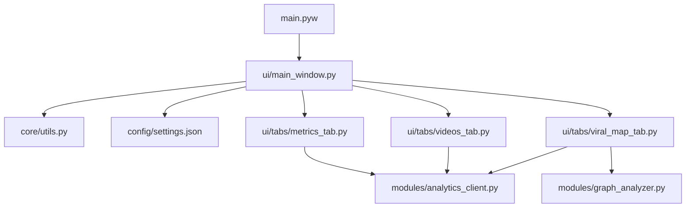

# Análisis Técnico y Arquitectónico de RedSilenceApp (Estructura Limpia)

Este documento presenta una radiografía técnica exhaustiva, detallada y libre de especulación sobre la aplicación **RedSilenceApp** después de la simplificación y reestructuración del proyecto, incluyendo los módulos de métricas, videos y el mapa de viralidad.

---

## 1. Arquitectura General del Sistema
La aplicación es una herramienta de escritorio construida sobre una arquitectura modular orientada a eventos con interfaz gráfica de escritorio basada en **CustomTkinter** y persistencia en archivos JSON locales.



### Tecnologías Clave Utilizadas
1. **Interfaz Gráfica:** `customtkinter` (interfaz oscura estilo premium con acentos en rojo neón), `tkinter` (diálogos de selección de archivos y ventanas de advertencia).
2. **Gráficos e Informes:** `matplotlib` (para renderizar curvas de rendimiento y grafos de co-ocurrencia en la interfaz) y un motor `Canvas` 2D alternativo como fallback sin dependencias externas.
3. **Persistencia de Datos:** Lectura y escritura asíncrona de archivos de configuración JSON.
4. **Clientes API de Google:** Integración de `youtubeAnalytics` (v2) y `youtube` (v3) mediante OAuth2 con flujos locales seguros.
5. **Modelado y Teoría de Grafos:** `networkx` para la modelización y estructuración de relaciones de co-ocurrencia de palabras.

---

## 2. Estructura de Archivos y Directorios

El código está organizado de la siguiente manera:

*   **`/` (Raíz):**
    *   `main.pyw`: Punto de entrada que inicializa y arranca la interfaz gráfica (`MainWindow`) sin consola visible en Windows.
*   **`core/` (Utilidades del Sistema):**
    *   [utils.py](file:///d:/Descargas/Desarrollo%20de%20aplicaciones/supergenerador/core/utils.py): Funciones de sistema (portapapeles persistente, foco forzado de ventanas).
*   **`ui/` (Interfaz Gráfica de Usuario):**
    *   [main_window.py](file:///d:/Descargas/Desarrollo%20de%20aplicaciones/supergenerador/ui/main_window.py): Ventana principal que administra el ciclo de vida de la aplicación, carga la configuración de los canales y gestiona la navegación entre vistas.
    *   **`ui/tabs/` (Pestañas de la Interfaz):**
        *   [metrics_tab.py](file:///d:/Descargas/Desarrollo%20de%20aplicaciones/supergenerador/ui/tabs/metrics_tab.py): Panel gráfico para visualizar las métricas y gráficos integrados con fallback en tk.Canvas.
        *   [videos_tab.py](file:///d:/Descargas/Desarrollo%20de%20aplicaciones/supergenerador/ui/tabs/videos_tab.py): Panel para visualizar e interactuar con la lista de videos subidos de cada canal, cargar transcripciones asíncronamente y abrir detalles.
        *   [viral_map_tab.py](file:///d:/Descargas/Desarrollo%20de%20aplicaciones/supergenerador/ui/tabs/viral_map_tab.py): Panel gráfico interactivo que visualiza el mapa de co-ocurrencia y viralidad de palabras de las transcripciones.
*   **`modules/` (Motores de Procesamiento y Clientes API):**
    *   [analytics_client.py](file:///d:/Descargas/Desarrollo%20de%20aplicaciones/supergenerador/modules/analytics_client.py): Módulo para realizar solicitudes a la API de YouTube Analytics, extraer videos subidos, refrescar tokens, descargar transcripciones y simular datos.
    *   [graph_analyzer.py](file:///d:/Descargas/Desarrollo%20de%20aplicaciones/supergenerador/modules/graph_analyzer.py): Analizador de texto que limpia, tokeniza, normaliza y procesa relaciones de co-ocurrencia de palabras clave.
*   **`config/` (Configuraciones):**
    *   `settings.json`: Almacena el listado de canales registrados por el usuario con sus respectivas APIs o archivos de credenciales.

---

## 3. Análisis de Módulos Centrales (Core)

### `core/utils.py`
*   **`get_resource_path(relative_path)`:** Devuelve la ruta absoluta del recurso. Si la aplicación fue empaquetada mediante PyInstaller, busca dentro de la carpeta temporal asignada en `sys._MEIPASS`, de lo contrario usa `os.path.abspath(".")`.
*   **`copy_to_clipboard_persistent(text)`:** Copia texto al portapapeles de Windows de forma permanente usando PowerShell como canal seguro para Unicode.
*   **`force_focus(window)`:** Fuerza que una ventana se mueva al primer plano de Windows aplicando temporalmente la propiedad `-topmost` y liberándola tras 200 ms.

---

## 4. Gestión de Configuración y Canales

### `config/settings.json`
Almacena el listado de canales configurados. Su estructura JSON es la siguiente:
```json
{
  "channels": [
    {
      "name": "Nombre del Canal",
      "platform": "YouTube | TikTok",
      "api_key": "Clave API (si aplica)",
      "credential_file": "Ruta al archivo de credenciales .json o .pickle"
    }
  ]
}
```

### Flujo de Inicialización de Vistas en `ui/main_window.py`
*   Al iniciar, el constructor de `MainWindow` lee `config/settings.json`.
*   **Si la lista de canales está vacía**: Limpia la pantalla y carga la vista **"Agregar Canales"** (`show_channel_setup_view`).
    *   El usuario puede ingresar el nombre del canal, la plataforma y la API key o archivo local de credenciales.
    *   El botón "Continuar al Panel Principal" se mantiene deshabilitado hasta que haya al menos un canal registrado.
*   **Si ya existen canales configurados**: Carga directamente la vista de **"Panel Principal" / Dashboard** (`show_dashboard_view`).
    *   Muestra un panel con barra lateral de navegación. Por defecto inicializa de forma persistente y perezosa las vistas de las pestañas (`VideosTab`, `MetricsTab`) y del panel Home, guardándolas en el diccionario `self.dashboard_views`.
    *   **Tarjetas de Canales con Logos Circulares**: Cada tarjeta dibuja en su centro un contenedor circular estilizado con borde neón del color de la plataforma. En segundo plano, se lanza de manera asíncrona `load_profile_pic_async` que obtiene la URL del logo de la caché local de métricas. Si el canal es de simulación (mock), o si la descarga falla (sin conexión, error SSL o timeout), la aplicación genera localmente un avatar circular estilizado con la inicial del canal y un color neón vibrante de fondo. Si la imagen es descargada, la almacena en disco en `config/cache/profile_pics/`, aplicando una máscara elíptica de Pillow para recortarla circularmente a 68x68 píxeles antes de mostrarla. En todos los casos se asegura la persistencia de la referencia al objeto `CTkImage` para evitar que la recolección de basura de Tkinter la haga invisible.
    *   **Navegación Persistente en Memoria**: Al pivotar entre pestañas en el Sidebar o mediante *quick jumps*, se oculta la pestaña previa (`pack_forget()`) y se visualiza la seleccionada (`pack()`). Esto elimina reconstrucciones de la interfaz, logrando transiciones instantáneas sin parpadeo y conservando los datos ya renderizados.
    *   Sincroniza la propiedad `active_channel_name` de `MainWindow` con los menús desplegables de las pestañas internas de forma que al hacer clic en los accesos rápidos de una tarjeta se preselecciona automáticamente ese canal en la vista correspondiente.
    *   Al agregar o eliminar canales en la pantalla de Ajustes, se notifica de forma inmediata a las pestañas activas llamando a `refresh_channel_list()` para sincronizar dinámicamente sus dropdowns.


---

## 5. Módulo de Inferencia y Métricas API

### `modules/analytics_client.py`
*   **`get_authenticated_services()`**: Inicializa los clientes OAuth para `youtubeAnalytics` (v2) y `youtube` (v3). Soporta expiración de tokens y auto-refresco asíncrono.
*   **`parse_iso8601_duration()`**: Utiliza expresiones regulares para convertir duraciones en formato estándar ISO 8601 a segundos de forma segura.
*   **`calculate_video_score()`**: Implementa la lógica de puntuación adaptativa para Shorts, Videos Largos y Directos. Aplica un suavizado Bayesiano en el denominador del ratio de interacción ($Views + 50$) para evitar inflar tasas en videos con muy pocas vistas. Si los datos de retención de la API de Analytics aún no están disponibles (duración de vista promedio igual a 0 en videos muy nuevos), calcula el score basándose en la interacción suavizada. Una vez consolidados los datos de retención, utiliza una fórmula ponderada: Retención de audiencia (AVP/tiempo absoluto, 55%) e Interacción (Likes, Comentarios, Compartidos, 45%), más un Bonus adicional por suscriptores ganados (hasta +10 pts extra), aplicando luego un multiplicador de credibilidad por volumen de vistas (logarítmico, alcanzando $1.0$ a partir de ~10,000 vistas) y sumando un Reach Bonus logarítmico basado en el volumen total de vistas (hasta +20 pts extra, capado todo en 100 pts), asignando un rango competitivo (S+, S, A, B, C, D) y su correspondiente color neón.
*   **`fetch_channel_data_and_analytics()`**: Obtiene la información básica del canal y sus métricas de los últimos 30 días de la API. Implementa un sistema de caché con expiración de 2 horas para evitar llamadas redundantes a la API de YouTube Analytics pero permitiendo actualizaciones frecuentes a lo largo del día.
*   **`load_metadata_cache()` / `save_metadata_cache()` y `load_metrics_cache()` / `save_metrics_cache()`**: Funciones de soporte para cargar y guardar las cachés locales en los archivos JSON de la carpeta `config/cache/`.
*   **`fetch_video_transcript(video_id)`**: Recupera de forma perezosa la transcripción oficial o autogenerada de subtítulos de YouTube en formato texto para un video, utilizando la API ligera `youtube-transcript-api` (instanciando la clase `YouTubeTranscriptApi` y extrayendo de forma robusta los subtítulos a partir de objetos o diccionarios del transcript). Ignora y elimina archivos de caché antiguos que contengan errores transitorios previos para forzar un reintento. Solo almacena en caché transcripciones exitosas o errores permanentes (subtítulos desactivados o no encontrados), omitiendo la persistencia de errores temporales (como videos privados o programados) para que se reintenten de forma automática en consultas posteriores.
*   **`fetch_channel_videos()`**: Consulta la API de YouTube Data v3 y la API de YouTube Analytics v2 de forma conjunta para extraer la lista de subidas del canal (hasta 500 videos paginados de a 50 por petición para asegurar la captura de videos largos, históricos y transmisiones en vivo), sus duraciones, descripciones, etiquetas e índices analíticos de los últimos 90 días, calculando dinámicamente el score y rango de cada video. Utiliza una caché de lista procesada (`config/cache/videos_list_cache.json`) que expira tras 2 horas de su creación para garantizar frescura en las métricas cambiantes, y una caché local de metadatos estáticos (duración, título, urls, descripción, tags) con política de expiración diaria. Soporta un parámetro `force_reload=True` para invalidar la caché en disco y forzar consultas frescas desde cero, omitiendo la caché de metadatos estáticos para corregir clasificaciones antiguas erróneas, repoblar descripciones/etiquetas, y eliminar los archivos de transcripción en caché correspondientes a los videos del canal para permitir una recarga limpia y completa de subtítulos. Los videos se clasifican como `"shorts"` si su duración es <= 60s, si el título contiene `"#shorts"`, o si tienen una duración de entre 60 y 180 segundos y se valida que no redirigen a la página normal de reproducción mediante una comprobación rápida de cabecera HTTP HEAD (aplicando un contexto SSL no verificado para evitar problemas con certificados SSL locales y un timeout de 5 segundos).
*   **`get_mock_channel_analytics()`**: Genera métricas simuladas de alta fidelidad para pruebas.
*   **`get_mock_channel_videos()`**: Genera una lista simulada de videos con estadísticas ficticias realistas y calcula sus scores/rangos algorítmicos. Mapea portadas ficticias para simulación.

### `ui/tabs/metrics_tab.py`
*   **`MetricsTab` (Clase)**: Pestaña que interactúa con el cliente de analíticas para mostrar los KPI de rendimiento, tasa de interacción y gráfico de evolución temporal con soporte de renderizado dual (Matplotlib / tk.Canvas).
    *   **Caché en Memoria y Pereza**: Almacena el canal cargado actual en `self.loaded_channel_name`. Si el usuario navega a esta sección y el canal activo no ha cambiado, no realiza ninguna petición a la API y reutiliza los datos en memoria. Si el canal activo difiere, actualiza el selector dropdown y solicita la información al cliente API (el cual implementa el caché en disco).
    *   **Indicador de Carga Inteligente**: Si existe caché diaria válida en disco para el canal antes de iniciar el hilo secundario, la pantalla de carga se personaliza mostrando `"Cargando desde caché local..."` para mayor transparencia del usuario.
    *   **Actualización Dinámica**: Soporta `refresh_channel_list()` para sincronizar los canales si hay cambios en los ajustes globales.

### `ui/tabs/videos_tab.py`
*   **`VideosTab` (Clase)**: Pestaña dedicada al listado de contenidos de forma estructurada, segmentada e independiente por canal.
    *   **Selección de Canal**: Menú desplegable para cambiar de canal.
    *   **Segmentación por Tipo (`CTkSegmentedButton`)**: Control visual premium para filtrar los contenidos cargados en tres pestañas de segmentación: **Shorts**, **Videos Largos** y **Directos**. Si una sección no tiene contenidos, muestra un mensaje explicativo adaptativo (ej. "No se encontraron directos para este canal").
    *   **Clasificación en Backend**: El backend consulta `liveStreamingDetails`, `duration`, la presencia del hashtag `"#shorts"` en el título y realiza una comprobación rápida de redirección mediante una petición HTTP HEAD en videos de duración intermedia (60s a 180s) para clasificar automáticamente cada subida en la categoría adecuada (Shorts, Videos Largos o Directos).
    *   **Puntuación Inteligente Ponderada**: Adapta la fórmula de retención (AVP) según el tipo de video:
        *   *Shorts*: Escala de 50% a 100% de retención.
        *   *Videos Largos*: Escala de 25% a 50% de retención (ajustada a la naturaleza del contenido de larga duración).
        *   *Directos*: Evaluados en base a tiempo absoluto de retención promedio por espectador (2 a 10 minutos).
    *   **Controles de Ordenamiento**: Menú desplegable para organizar los videos por "Fecha (Recientes)", "Título (A-Z)" y "Puntuación (Mayor a Menor)" dentro del segmento seleccionado.
    *   **Caché en Memoria y Pereza**: Almacena el canal cargado actual en `self.loaded_channel_name`. Si se navega a la sección de videos y el canal cargado coincide con el activo, evita cualquier consulta de API o indicador de carga, mostrando los videos ya renderizados al instante.
    *   **Indicador de Carga Inteligente**: Si la app se inicia de cero y la caché en disco (2h) está disponible, la pantalla de carga temporal muestra el mensaje `"Cargando desde caché local..."` antes de inyectar las tarjetas desde el disco.
    *   **Botón de Fórmula (`ⓘ Fórmula`)**: Abre una ventana modal emergente (`CTkToplevel`) centrada que detalla la fórmula matemática adaptativa de puntuación y los rangos de clasificación.
    *   **Visualización (Portadas Reales)**: Tarjetas de video estilizadas que muestran el índice o posición del video (`#1`, `#2`, etc.) en el extremo izquierdo y cargan la miniatura/portada real de forma asíncrona. La interfaz limita el renderizado a los primeros **50 videos** del segmento seleccionado para evitar sobrecargar CustomTkinter. Además, utiliza un ejecutor de hilos controlado (`ThreadPoolExecutor` con un máximo de 2 hilos simultáneos) para cargar y procesar las portadas de forma secuencial y suave, previniendo cuellos de botella de GIL y saturación del bucle de eventos que congelaban la ventana de la aplicación.
    *   **Asincronía**: Carga de metadatos e imágenes mediante hilos de fondo y comunicación segura con el hilo de Tkinter (`after()`), evitando bloqueos en la interfaz gráfica.
    *   **Botón y Ventana de Detalles**: Cada tarjeta de video cuenta con un botón `"DETALLES"` que abre un modal flotante (`CTkToplevel`) centrado. Este visor muestra las estadísticas clave del video, las etiquetas (tags), la descripción completa en una caja de texto de lectura, y arranca un hilo secundario para descargar de forma asíncrona la transcripción del audio de YouTube (evitando congelar la UI y mostrándola en cuanto se guarda en la caché local de disco).

### `ui/tabs/viral_map_tab.py`
*   **`ViralMapTab` (Clase)**: Nueva pestaña dedicada al análisis visual de la viralidad mediante redes de co-ocurrencia.
    *   **Lienzo de Redes Embebido**: Integra una figura de Matplotlib embebida mediante `FigureCanvasTkAgg` en el marco de la UI. Dibuja dinámicamente un grafo de red utilizando los nodos y aristas de `networkx` aplicando un layout de resortes estable con dispersión adaptable (`k` dinámico) e iteraciones optimizadas para prevenir superposiciones.
    *   **Diseño Neón Horror Premium**: Dibuja los nodos como anillos oscuros con bordes de degradado neón mediante una normalización min-max dinámica de los scores activos (desde rojo oscuro `#55000C` hasta rojo neón ardiente `#FF003C`). Los tamaños de los nodos se escalan sublinealmente (basado en la raíz cuadrada de la frecuencia) para evitar solapamientos masivos. Las etiquetas de texto de cada nodo tienen un efecto de silueta (borde) negro grueso de 3.5 px para garantizar lectura legible sobre cualquier fondo, y las aristas se dibujan en rojo neón transparente con grosor proporcional al grado de co-ocurrencia.
    *   **Tabla de Palabras Clave**: Muestra en el panel derecho scrollable un listado ordenado de los términos más virales, indicando su frecuencia de aparición y su score promedio con su correspondiente rango y color.
    *   **Filtros Interactivos**: Incluye un `CTkSegmentedButton` para cambiar entre segmentos (Shorts, Videos Largos, Directos, Todos) y un `CTkSlider` para filtrar por frecuencia mínima de aparición.
    *   **Procesamiento Asíncrono**: Realiza la computación matemática en un hilo de fondo y delega el redibujado de Matplotlib al hilo principal de Tkinter vía `.after()`, evitando bloqueos.

### `modules/graph_analyzer.py`
*   **`tokenize(text)`**: Limpia textos eliminando números, caracteres especiales y signos de puntuación, filtrando palabras de longitud corta (<= 2) y excluyendo una lista de más de 120 palabras vacías (*stop words*) en español e inglés.
*   **`get_video_keywords(video)`**: Combina el título y las etiquetas oficiales del video, agregando los 10 términos más frecuentes de la descripción y transcripción (leída de la caché local) para obtener un listado balanceado de palabras clave por video.
*   **`generate_viral_graph_data(videos)`**: Filtra videos por tipo, procesa sus palabras clave, acumula frecuencias y puntuaciones promedio, e identifica enlaces de co-ocurrencia. Construye y devuelve un grafo no dirigido de `networkx.Graph` y un listado ordenado por score promedio.


