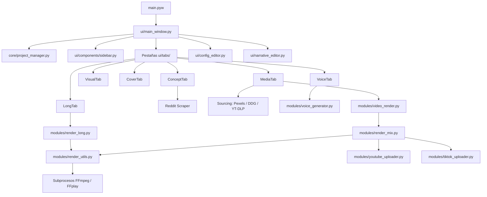

# Análisis Técnico y Arquitectónico de SilencioRojoApp

Este documento presenta una radiografía técnica exhaustiva, detallada y libre de especulación sobre la aplicación **SilencioRojoApp**. Describe la funcionalidad exacta de cada archivo de código fuente, sus interconexiones, variables y los algoritmos que la componen. Su objetivo es servir como memoria persistente para futuras consultas técnicas o de mantenimiento por parte de desarrolladores o sistemas de Inteligencia Artificial.

---

## 1. Arquitectura General del Sistema
La aplicación está construida sobre una arquitectura modular orientada a eventos con interfaz gráfica de escritorio en **CustomTkinter** y procesamiento multimedia basado en **FFmpeg**.

### Tecnologías Clave Utilizadas
1. **Interfaz Gráfica:** `customtkinter` (interfaz oscura neon-horror), `tkinter` (diálogos del sistema).
2. **Procesamiento de Audio y Video:** `FFmpeg` y `FFplay` invocados asíncronamente mediante `subprocess`, `PIL` (Pillow) para generación de tarjetas dinámicas de Reddit y conversor de imágenes.
3. **Servicios de IA:** `google-generativeai` (Gemini 2.5/2.0), `google-genai` (SDK unificado de Google Gen AI para TTS), `groq` (Llama 3.3 y Whisper-large-v3).
4. **Adquisición de Contenido:** `yt_dlp` para descargar gameplays de YouTube, `duckduckgo_search` y scrapers HTTP para imágenes/GIFs de Roblox, API de Pexels para videos de B-roll.
5. **Autenticación y Publicación:** `google-api-python-client` y `google-auth-oauthlib` para la API de YouTube V3.

---

## 2. Estructura Detallada de Archivos y Directorios

El código está organizado en carpetas funcionales:

*   **`/` (Raíz):**
    *   `main.pyw`: Punto de entrada que inicializa y arranca la interfaz gráfica (`MainWindow`) sin consola visible en Windows.
*   **`core/` (Utilidades del Sistema y Lógica de Datos):**
    *   [project_manager.py](file:///d:/Descargas/SilencioRojoApp/core/project_manager.py): Maneja el estado, guardado automático y migración de la estructura de archivos de los proyectos.
    *   [math_logic.py](file:///d:/Descargas/SilencioRojoApp/core/math_logic.py): Lógica matemática y sincronización visual.
    *   [utils.py](file:///d:/Descargas/SilencioRojoApp/core/utils.py): Funciones de sistema (portapapeles persistente, foco forzado de ventanas).
*   **`modules/` (Motores de Procesamiento y Clientes API):**
    *   [gemini_client.py](file:///d:/Descargas/SilencioRojoApp/modules/gemini_client.py): Cliente de generación de texto para Google Gemini (`gemini-2.5-flash`).
    *   [groq_client.py](file:///d:/Descargas/SilencioRojoApp/modules/groq_client.py): Cliente de generación de texto para Groq (`llama-3.3-70b-versatile`).
    *   [voice_generator.py](file:///d:/Descargas/SilencioRojoApp/modules/voice_generator.py): Sintetizador de voz TTS de Gemini (Voz Charon, 24kHz, 16-bit Mono WAV).
    *   [pexels_client.py](file:///d:/Descargas/SilencioRojoApp/modules/pexels_client.py): Cliente para descargar videos de stock de la API de Pexels.
    *   [roblox_sourcing.py](file:///d:/Descargas/SilencioRojoApp/modules/roblox_sourcing.py): Búsqueda y descarga de capturas y GIFs de Roblox a través de DuckDuckGo.
    *   [gameplay_sourcing.py](file:///d:/Descargas/SilencioRojoApp/modules/gameplay_sourcing.py): Descargador de videos de fondo y segmentador de clips mediante `yt-dlp`.
    *   [youtube_uploader.py](file:///d:/Descargas/SilencioRojoApp/modules/youtube_uploader.py): Automatizador de subida de videos a YouTube con programación automática.
    *   [tiktok_uploader.py](file:///d:/Descargas/SilencioRojoApp/modules/tiktok_uploader.py): Automatizador de subida de videos a TikTok v2 mediante la API oficial, soportando OAuth2 (PKCE) y subida fragmentada por bloques (Direct Post e Inbox Draft).
    *   [render_utils.py](file:///d:/Descargas/SilencioRojoApp/modules/render_utils.py): Utilidades de renderizado (detección de codificadores por hardware, transcriptor Groq Whisper, conversor ASS, generador de tarjetas Reddit, generador de tablas LUT).
    *   [render_mix.py](file:///d:/Descargas/SilencioRojoApp/modules/render_mix.py): Motor de renderizado para videos cortos (Shorts) en formato vertical.
    *   [render_long.py](file:///d:/Descargas/SilencioRojoApp/modules/render_long.py): Motor de renderizado para videos largos multipágina y multicapítulo.
    *   [video_render.py](file:///d:/Descargas/SilencioRojoApp/modules/video_render.py): Enrutador unificado que delega la renderización final al motor `render_mix`.
    *   [video_compositor.py](file:///d:/Descargas/SilencioRojoApp/modules/video_compositor.py): Mezclador de transparencias con ImageIO (actualmente en desuso, reemplazado por filtros FFmpeg nativos).
    *   [video_benchmark.py](file:///d:/Descargas/SilencioRojoApp/modules/video_benchmark.py): Módulo de análisis comparativo (benchmark) para descargar audio de YouTube, transcribir localmente con Whisper y comparar con la competencia mediante IA.
*   **`ui/` (Interfaz Gráfica de Usuario):**
    *   [main_window.py](file:///d:/Descargas/SilencioRojoApp/ui/main_window.py): Ventana principal que administra el ciclo de vida de la aplicación, el guardado de sesión y la navegación de vistas.
    *   [config_editor.py](file:///d:/Descargas/SilencioRojoApp/ui/config_editor.py): Diálogo flotante para editar API keys, rutas del sistema y plantillas prompts con editor de texto interactivo con coloreado de sintaxis.
    *   [narrative_editor.py](file:///d:/Descargas/SilencioRojoApp/ui/narrative_editor.py): Diálogo para modificar las variables aleatorias de la narrativa (ganchos, monstruos, atmósfera, cierres).
    *   [image_converter.py](file:///d:/Descargas/SilencioRojoApp/ui/image_converter.py): Conversor masivo de imágenes de PNG a JPG de alta calidad.
    *   [visual_prompt_viewer.py](file:///d:/Descargas/SilencioRojoApp/ui/visual_prompt_viewer.py): Visor incremental no bloqueante para copiar prompts individuales de generación de imágenes.
    *   **`ui/components/` (Widgets Reutilizables):**
        *   [sidebar.py](file:///d:/Descargas/SilencioRojoApp/ui/components/sidebar.py): Barra lateral fija de 60px para navegación rápida entre pestañas.
    *   **`ui/tabs/` (Pestañas de la Ventana Principal):**
        *   [concept_tab.py](file:///d:/Descargas/SilencioRojoApp/ui/tabs/concept_tab.py): Generador de ideas de guiones narrativos, con raspador integrado para subreddits de terror.
        *   [visual_tab.py](file:///d:/Descargas/SilencioRojoApp/ui/tabs/visual_tab.py): Creador de prompts para imágenes basados en el tiempo de duración estimado.
        *   [cover_tab.py](file:///d:/Descargas/SilencioRojoApp/ui/tabs/cover_tab.py): Creador de prompts para la portada del Short.
        *   [voice_tab.py](file:///d:/Descargas/SilencioRojoApp/ui/tabs/voice_tab.py): Panel de pruebas para generación manual de audio TTS con la voz de Gemini Charon.
        *   [media_tab.py](file:///d:/Descargas/SilencioRojoApp/ui/tabs/media_tab.py): Línea de tiempo interactiva de Shorts, descarga automática de gameplays/Roblox, previsualizaciones de BGM, doblaje y subida de videos.
        *   [long_tab.py](file:///d:/Descargas/SilencioRojoApp/ui/tabs/long_tab.py): Panel de control para videos largos (16:9), segmentación de guiones en capítulos y compilación con caché inteligente.
        *   [comparator_tab.py](file:///d:/Descargas/SilencioRojoApp/ui/tabs/comparator_tab.py): Panel de benchmarking narrativo. Descarga audios de YouTube, calcula métricas de WPM y silencios, y genera reportes de auditoría de IA.
*   **`config/` (Ajustes, Datos Narrativos y Prompts Maestros):**
    *   `settings.json`: Almacena API keys del usuario, rutas locales de medios, motor activo y plantillas seleccionadas.
    *   `narrative_vars.json`: Almacena la base de datos de ganchos, criaturas, ambientes y cierres.
    *   [prompts.py](file:///d:/Descargas/SilencioRojoApp/config/prompts.py): Resuelve y expone los prompts prompts maestros dinámicamente.
    *   **`config/prompts/`:** Carpeta dividida en categorías (`story`, `visuals`, `cover`, `voice`) que contiene los archivos de texto (`.txt`) correspondientes a las plantillas maestras de prompts de IA.

---

## 3. Análisis de Módulos Centrales (Core)

### `core/project_manager.py`
Administra el almacenamiento físico del estado de la aplicación.
*   **`__init__(projects_dir="projects")`:** Inicializa el directorio de almacenamiento y ejecuta la migración automática de archivos antiguos.
*   **`migrate_old_projects()`:**
    1.  Toma archivos `.json` sueltos en `projects/` y los mueve a subcarpetas en base a su ID (Ej: `projects/<project_id>/state.json`).
    2.  Busca carpetas de doblaje antiguas sueltas en `projects/` que coincidan con los nombres de proyectos y las reubica bajo `projects/<project_id>/dubs/`.
    3.  Mueve la caché antigua de videos largos ubicada en `projects/videos_largos/` a `cache/videos_largos/`, limpiando directorios vacíos.
*   **`create_project(title)`:** Limpia el título quitando caracteres especiales y genera un `current_project_id` formateado como `<timestamp>_<title_with_underscores>`. Crea la carpeta en disco de forma inmediata.
*   **`save_project(data, project_id=None)`:** Escribe la estructura de datos en formato JSON identado con codificación `utf-8` en `projects/<project_id>/state.json`. Agrega metadatos como la versión del estado (`_version: "1.0"`) y el timestamp de modificación (`_last_modified`).
*   **`load_project(project_id)`:** Retorna la deserialización JSON del archivo de estado del proyecto. Incorpora compatibilidad de retroceso para leer archivos `.json` sueltos antiguos si es necesario.
*   **`list_projects()`:** Escanea `projects/` para listar las subcarpetas que contienen `state.json`. Ordena las carpetas basándose en la fecha de modificación del archivo `state.json` (más reciente primero).

### `core/math_logic.py`
*   **`calculate_visual_segments(audio_duration_seconds)`:** Implementa la "Regla de los 3 segundos": estima cuántas imágenes se necesitan para cubrir la duración de un video de forma fluida. Retorna $\lceil \text{duración} / 3.0 \rceil$.

### `core/utils.py`
*   **`get_resource_path(relative_path)`:** Devuelve la ruta absoluta del recurso. Si la aplicación fue empaquetada mediante PyInstaller, busca dentro de la carpeta temporal asignada en `sys._MEIPASS`, de lo contrario usa `os.path.abspath(".")`.
*   **`copy_to_clipboard_persistent(text)`:** Copia texto al portapapeles del sistema operativo de forma permanente (sobrevive al cierre del programa). En Windows ejecuta un subproceso de PowerShell en segundo plano con el comando `Set-Clipboard -Value $input` enviando el texto en codificación `utf-8` para mantener compatibilidad con caracteres Unicode. Si PowerShell falla, usa `clip.exe` como fallback (reemplazando caracteres especiales incompatibles mediante codificación `cp1252`).
*   **`force_focus(window)`:** Estrategia para mover ventanas al primer plano en Windows. Llama a `window.lift()`, `window.focus_force()`, establece temporalmente el atributo `-topmost` a `True`, y programa un retraso de 200 ms mediante `window.after` para desactivar el `-topmost` y no bloquear la experiencia de usuario.

---

## 4. Clientes API y Motores de Servicios (IA & Sourcing)

### `modules/gemini_client.py`
Envía peticiones de texto a la API oficial de Google Generative AI.
*   **`validate_api_key(api_key)`:** Verifica que la API key no esté vacía y tenga una longitud mínima de 30 caracteres.
*   **`generate_content(prompt, api_key, model_name="gemini-2.5-flash")`:** Configura el cliente con `genai.configure(api_key)`. Utiliza `genai.GenerativeModel` con parámetros específicos: `temperature=0.9` (promover creatividad narrativa) y `max_output_tokens=32000` (soporte para listas de prompts extensas).

### `modules/groq_client.py`
Utiliza el cliente de Groq para inferencia rápida de texto.
*   **`generate_content(prompt, api_key, model_name="llama-3.3-70b-versatile")`:** Realiza llamadas de chat completion instantáneas con `temperature=0.9` y un límite controlado de `max_completion_tokens=4000`.

### `modules/voice_generator.py`
Gestiona la generación de voz sintética (TTS) usando los modelos de audio de Gemini.
*   **`generate_voice(text, api_key, voice_instructions_path, output_path, model_name="gemini-2.5-flash-preview-tts")`:**
    *   Lee las instrucciones de entonación y estilo del archivo en `voice_instructions_path`.
    *   Prepara el cuerpo del prompt uniendo las instrucciones con el guion limpio a leer.
    *   Usa el nuevo SDK `google-genai` instanciando `genai.Client(api_key)`.
    *   Configura la generación indicando la modalidad de respuesta de audio (`response_modalities=["AUDIO"]`) y aplicando la voz preconfigurada **Charon** en `types.VoiceConfig`.
    *   Extrae los bytes de audio en crudo a partir de `response.candidates[0].content.parts[...].inline_data.data`.
    *   Escribe y guarda los bytes en el disco duro estructurando un archivo `.wav` limpio codificado a **24kHz, 16-bit PCM Mono** utilizando la librería nativa `wave` de Python.

### `modules/pexels_client.py`
Permite obtener B-rolls (videos secundarios) de stock para insertarlos sobre los momentos clave de terror.
*   **`search_pexels_video(query, api_key, orientation="portrait")`:** Envía una solicitud HTTP GET autorizada con la clave de Pexels a la API de búsqueda, solicitando orientación vertical (`portrait`). Aplica una mezcla aleatoria (`random.shuffle`) sobre los resultados obtenidos para evitar videos repetitivos y selecciona preferentemente enlaces de calidad "hd" en formato "mp4".
*   **`download_video_file(video_url, output_path)`:** Descarga el archivo de video de forma segura escribiendo bloques en memoria de 512 KB para evitar el desbordamiento de RAM con videos grandes.
*   **`extract_keywords_from_prompt(scene_text, api_key, provider="gemini")`:** Envía el prompt de escena a un modelo LLM (Gemini o Groq Llama 3) con instrucciones de actuar como editor de video y resumir el texto en una consulta de 1 o 2 palabras clave en inglés (ej: "scary shadow", "dripping faucet").

### `modules/roblox_sourcing.py`
Adquiere capturas de pantalla y GIFs animados del juego de Roblox correspondiente.
*   **`get_vqd(query)`:** Realiza una petición inicial a `duckduckgo.com` para obtener el token dinámico de sesión `vqd` requerido por su API interna de búsqueda de imágenes.
*   **`search_images(query, vqd, search_gifs=False)`:** Petición HTTP manual a la API `duckduckgo.com/i.js` con el token de sesión, aplicando filtros especiales si se buscan GIFs.
*   **`download_roblox_media(...)`:**
    *   Determina la consulta de búsqueda según el juego (Ej: `"Roblox <game_name> horror gif"` para animaciones).
    *   Utiliza la librería oficial `duckduckgo_search.DDGS` de forma asíncrona. Aplica reintentos y esperas de incremento exponencial (2s, 4s, 8s) si detecta bloqueos de límite de tráfico (errores 403 / Ratelimit).
    *   Si la librería falla, utiliza la función fallback clásica de raspado HTTP manual (`search_images`).
    *   Descarga las imágenes a disco en `assets/images/`. Si detecta que un recurso de animación es un GIF o un WebP animado camuflado con extensión `.gif`, utiliza la librería **Pillow** en Python para extraer de forma asíncrona todos sus fotogramas y compila con **FFmpeg** un archivo de vídeo `.mp4` real compatible H.264 (ajustando las dimensiones a valores pares). El archivo original se elimina y el video resultante se añade a la línea de tiempo, previniendo fallos de decodificación en FFmpeg al no soportar de forma nativa los WebPs animados.

### `modules/gameplay_sourcing.py`
Obtiene gameplays genéricos de fondo (como Subway Surfers o Minecraft Parkour) para acompañar la historia en Shorts de alta retención.
*   **`download_youtube_gameplay(query_or_url, output_dir, status_callback=None)`:** Utiliza `yt_dlp` para buscar y descargar la pista de video de YouTube. Usa filtros de formato estrictos para limitar la descarga a una resolución máxima de 720p en contenedor MP4 (`'bestvideo[height<=720][ext=mp4]/best[height<=720][ext=mp4]/best'`), lo que agiliza el render y reduce el ancho de banda.
*   **`slice_video_segments(...)`:** Corta el video base descargado en segmentos aleatorios de 5 a 12 segundos usando FFmpeg.
    *   Aplica un filtro complejo de rediseño vertical de aspecto: divide el flujo en dos (`split`), desenfoca la pista de fondo con `boxblur=20:10` y escala la pista frontal para que quepa en el centro de la pantalla vertical sin recortes laterales excesivos (`overlay=y=(H-h)/2`).
    *   Codifica los clips a 720p sin audio (`-an`) a través de H.264 usando el preset ultra-rápido de FFmpeg (`-preset ultrafast`) y un factor de compresión alto (`-crf 28`).

### `modules/youtube_uploader.py`
*   **`get_authenticated_service(...)`:** Autentica la conexión OAuth2 con YouTube. Lee el cliente desde `config/client_secrets.json` y almacena los tokens dinámicos refrescables en `config/token.pickle` para evitar inicios de sesión repetidos.
*   **`upload_video(file_path, title, description, keywords="", status_callback=None)`:**
    *   Calcula el horario de publicación objetivo de forma automática: **6:15 PM** de lunes a viernes, o **10:00 AM** si es sábado o domingo. Si la hora del día actual ya superó el objetivo, lo programa para el día siguiente.
    *   Agrega la etiqueta obligatoria `#Shorts` al título y descripción.
    *   Construye el cuerpo de metadatos del video insertando la categoría de Entretenimiento ("24"), el idioma español, marca el video para contenido no infantil, y activa el campo `selfDeclaredMadeForSyntheticContent: True` para indicar a YouTube que fue creado con Inteligencia Artificial.
    *   Sube el video en trozos manejando el callback de progreso de red y abre el enlace del video finalizado al terminar.

### `modules/tiktok_uploader.py`
*   **`generate_pkce()`**: Genera el `code_verifier` y `code_challenge` encriptados bajo SHA256 para el flujo seguro PKCE requerido por TikTok.
*   **`get_authenticated_token(status_callback=None)`**: Inicia un servidor web HTTP temporal en el puerto local 8080 para capturar la redirección del navegador con el código de autenticación de TikTok, el cual posteriormente intercambia por el par de tokens (`access_token` y `refresh_token`). Almacena los tokens en `config/tiktok_token.json` y gestiona su expiración y refresco de forma automática.
*   **`upload_video_tiktok(file_path, title, status_callback=None, upload_mode="publish")`**:
    *   Inicializa la sesión de subida en TikTok para la publicación directa (modo `publish`) o en la bandeja de entrada como borrador (modo `inbox`).
    *   Lee secuencialmente el video y realiza múltiples peticiones HTTP `PUT` enviando bloques de 5MB con la cabecera `Content-Range` correspondiente al pre-signed URL del almacenamiento temporal de TikTok (GCS).
    *   Ejecuta un bucle de sondeo (polling) consultando el estado de procesamiento del video cada 5 segundos hasta comprobar su publicación definitiva o identificar fallos de codificación/moderación.

---

## 5. Motores de Renderizado Audiovisual (Filtros y FFmpeg)

### `modules/render_utils.py`
*   **`detect_hardware_encoder(output_folder)`:** Prueba de forma nativa qué codificadores gráficos de hardware están disponibles en el equipo del usuario. Ejecuta comandos de prueba FFmpeg de 0.1 segundos con una fuente de color constante, evaluando secuencialmente NVIDIA NVENC (`h264_nvenc`), AMD AMF (`h264_amf`), e Intel QSV (`h264_qsv`). Si alguno funciona, guarda los parámetros de codificación específicos en un archivo de caché local `cache/detected_encoder.json` para agilizar los siguientes renders. Si todos fallan, asigna el codificador de software clásico (`libx264 ultrafast`).
*   **`convert_to_word_by_word_srt(json_path, srt_path, ...)`:** Toma el JSON de palabras de Whisper y genera un archivo de subtítulos de formato ASS (`.ass`). Soporta tres estilos visuales altamente refinados:
    1.  **TikTok / Hormozi (Alto impacto):** Texto centralizado en Arial Black gigante con contorno de 4px, rotaciones alternadas de 4 y -4 grados por palabra (`{\frz4...}` / `{\frz-4...}`), efecto pop-in de escala rápida, resalta palabras clave de terror en rojo brillante (#FF0033)/cian, y añade emojis correspondientes en las palabras que coinciden (ej: 🩸, 💀, 👻, 🏠, 🚪).
    2.  **Reddit History:** Texto centrado-inferior seguro para Shorts, sin emojis ni rotaciones inclinadas. Aplica colores de contraste (amarillo neón y verde neón) y una animación bounce de pop-in de 125% a 100% de escala en los primeros 150 ms (`{\fscx125\fscy125\t(0,150,\fscx100\fscy100)}`).
    3.  **Roblox Gaming:** Tipografía limpia en Arial Black con contorno negro ultra grueso (8px), sombra sutil (4px) y fondo negro semi-transparente (`BackColour=&H99000000`) para garantizar legibilidad óptima sobre gameplays saturados de color, aplicando una escala de 120% a 100% en 120ms (`{\fscx120\fscy120\t(0,120,\fscx100\fscy100)}`).
*   **`extract_sfx_events(json_path)`:** Escanea el texto transcrito buscando palabras de misterio y retorna marcas de tiempo asociadas a SFX específicos en `assets/audio/sfx/` (ej: "grito" -> `scream.mp3`, "puerta" -> `door.mp3`, "pasos" -> `footsteps.mp3`, "corazón" -> `heartbeat.mp3`).
*   **`generate_reddit_card(title, output_path, aspect_ratio="9:16")`:** Dibuja dinámicamente con PIL una tarjeta de publicación de Reddit AskReddit en modo oscuro. Configura la tipografía Arial Bold, calcula el alto dinámico según la cantidad de texto (con saltos de línea inteligentes), dibuja el logotipo oficial, metadatos y botones de pie de página (Upvotes y comentarios). El resultado se guarda como PNG transparente para superponerlo en el video.
*   **`generate_default_luts()` y `write_lut()`:** Genera de forma algorítmica archivos LUT 3D (`.cube`) a partir de funciones de color específicas:
    1.  **Gore Rojo:** `(min(1.0, r * 1.4), g * 0.6, b * 0.6)`.
    2.  **Terror Frío:** `(r * 0.65, min(1.0, g * 1.05), min(1.0, b * 1.35))`.
    3.  **Misterio Oscuro:** Aplica una curva sigmoidea $3x^2 - 2x^3$ atenuada al 0.85 para saturar oscuros.
    4.  **Vintage VHS:** Matriz de conversión sepia adaptada con leves incrementos de brillo mínimo.

### `modules/render_mix.py`
El motor de renderizado para videos cortos (Shorts).
1.  **Trim de Silencio:** Recorta silenciados al inicio del audio mediante el filtro `silenceremove=start_periods=1:start_duration=0:start_threshold=-40dB`.
2.  **Audio Speed Ramping:** Si el texto de un segmento de Whisper contiene palabras de terror, el motor ralentiza el tempo a `0.90x` para aumentar la tensión. Si es texto de relleno, lo acelera a `1.08x` para retención. Los segmentos se concatenan con el filtro `atempo` y los timestamps del JSON de subtítulos se recalculan proporcionalmente.
3.  **Descarga de B-rolls:** Si hay una API Key de Pexels configurada, busca B-rolls utilizando los nombres de los elementos en pantalla identificados en el guion, los descarga y calcula sus intervalos para superponerlos sobre el video sin colisionar con otros clips.
4.  **Cálculo de Tiempos y Cortes Asimétricos:** Distribuye de forma asimétrica la duración de los clips en el timeline. Hay un 18% de probabilidad de generar "flash cuts" rápidos (duración de 0.12s a 0.20s), y el resto son cortes irregulares normales, reservando 0.25s fijos para clips subliminales.
5.  **Render de Clips en Paralelo (`process_chunk`):** Procesa los clips en paralelo a través de un pool de hilos (`ThreadPoolExecutor` limitado a un máximo de 2 trabajadores).
    *   **Gestión de GIFs Animados:** Si un clip tiene la extensión `.gif`, utiliza la opción de entrada de FFmpeg `-ignore_loop 0` en lugar de `-stream_loop -1` (que causa bloqueos en el demuxer de GIFs de FFmpeg en Windows). Esto mantiene la animación del GIF en reproducción continua y permite que sea procesado como un flujo de video.
    *   **Efectos Subliminales:** Aplica desenfoque dinámico (`boxblur=2:1`) y parpadeo rápido de brillo (`eq=brightness='0.2*sin(30*PI*t)'`).
    *   **Glitches y Temblor de Terror:** Si el clip se cruza con una palabra clave de terror en el guion, activa un filtro de sacudida y glitch visual cromático (`negate` y `noise`) sincronizado con la palabra.
    *   **Ken Burns y Zoompan:** Aplica paneos horizontales y verticales. Si el clip dura más de la media, aplica un re-encuadre automático del 1.1x al 1.35x al llegar al 60% de su duración (Jump Cut de tensión) utilizando la variable de tiempo de salida `time` en lugar de `in_time` para evitar errores de evaluación matemática (`NAN`) en entradas con timestamps inestables (como GIFs en bucle).
    *   **Ganchos Visuales:** Para el clip inicial (`i == 0`), inyecta un strobe blanco y negro al inicio. Si el estilo es Reddit, superpone la tarjeta AskReddit generada con una animación slide-up exponencial (`overlay=y='((H-h)/2+(H-(H-h)/2)*exp(-8*t))*lt(t,0.6)...'`). Si es Roblox, añade un cartel estático estilo gaming naranja/blanco.
    *   **Mezcla de Estilo VHS:** Mezcla una textura de ruido de VHS analógico (`vhs_overlay.mp4`) en modo screen con una opacidad baja del 8% (`blend=all_mode=screen:all_opacity=0.08`).
6.  **Paso 1: Composición de Video:** Concatenación de clips usando filtros `xfade` (transiciones aleatorias de 0.5s como pixelado, zoom, barrido radial, etc.) y quema los subtítulos ASS (`subtitles=filename='...'`). El video resultante se genera como un flujo de transporte MPEG-TS temporal (`mpegts`).
7.  **Paso 2: Composición de Audio:**
    *   Aplica normalización de volumen (`loudnorm=I=-16`) e inyecta la narración de voz.
    *   Crea un canal paralelo de voz y aplica compresión sidechain (ducking) sobre la música de fondo (`sidechaincompress=threshold=0.04:ratio=6`), reduciendo la música un 70% cuando habla el narrador.
    *   Coloca efectos de transición (risers, impacts, glitches) coordinados con las transiciones `xfade` de video.
    *   Inyecta un sonido de impacto o tensión ("screamer" / "despertador") a la mitad del video (48% de la duración) seleccionado aleatoriamente de un pool compuesto por efectos de transición y de horror (`real_glitch`, `real_boom`, `real_impact`, `real_whoosh`, `scream`, `whisper`, `heartbeat`, `breathing`). Para garantizar la consistencia de volumen y evitar que audios largos alteren la mezcla, se recortan estrictamente a 2.5 segundos con un fade-out de 1.0 segundo de duración en la salida.
    *   Mezcla los SFX de palabras clave y el sonido original de los clips de video activos.
    *   Concatena y guarda todo en el archivo final `.mp4`.
9.  **Optimización de Memoria en Subprocesos (FFmpeg):** Para evitar que el heap de Python se agote acumulando bitácoras de renderizado extensas en la variable de captura, el motor redirige el stderr de FFmpeg a archivos de log físicos en disco (`cache/ffmpeg_video_err.log`, etc.) y descarta el stdout mediante `subprocess.DEVNULL`. Estos logs se leen únicamente si el subproceso falla, garantizando el consumo de RAM en 0 bytes para logs en renders exitosos.
8.  **Auto Doblajes Traducidos:** Llama a la función `auto_generate_translated_dubs` para traducir el guion a Francés, Italiano y Alemán. Genera audios sintéticos mediante Edge-TTS con las voces `HenriNeural`, `DiegoNeural` y `ConradNeural` respectively. Posteriormente, ajusta la velocidad del audio traducido mediante el filtro `atempo` para que dure exactamente lo mismo que la narración original en español, traduce los metadatos de texto y mezcla el audio doblado resultante con la música de fondo.

### `modules/render_long.py`
Optimizado para renderizar videos largos en formato horizontal (16:9).
*   **`convert_to_phrase_ass(...)`:** Agrupa palabras en frases de 3 a 6 palabras basándose en pausas de tiempo mayores a 0.35s o signos de puntuación. Aplica intermitencia de visualización para evitar que la pantalla se sature.
*   **`render_chapter(...)`:**
    *   Si el capítulo es mayor a 0, dibuja una **Title Card** (pantalla de título) de 7.0 segundos con fondo negro, estática de video (`noise=alls=18:allf=t`), zumbido de misterio a 55Hz, y el título en mayúsculas rojas grandes.
    *   Aplica el efecto de movimiento Ken Burns sobre las imágenes asignadas (pan, tilt, o desplazamientos diagonales) variando el movimiento de forma cíclica según el índice del recurso.
    *   Aplica un fundido final a negro de 1.2 segundos al terminar el capítulo (dramatismo).
    *   **Optimización de Memoria (FFmpeg):** Escribe las bitácoras de error de FFmpeg directamente en un log de disco (`[capítulo]_ffmpeg_err.log`) y redirige stdout a `DEVNULL` para evitar caídas de memoria (`MemoryError`) durante la codificación.
*   **`render_long_video_project(...)`:**
    *   Renderiza cada capítulo de forma secuencial (`max_workers=1`) para proteger el procesador y evitar bloqueos en hardware modesto.
    *   Implementa caché inteligente de render: calcula la firma/metadatos de cada capítulo (guion, título, audios de voz e imágenes con sus fechas de modificación y tamaños). Si el capítulo no ha sufrido cambios, reutiliza el chunk pre-renderizado `chapter_X.mp4` evitando codificar de nuevo.
    *   Une los capítulos de forma instantánea y sin pérdida usando la directiva `concat` de FFmpeg sin re-codificación de video (`-c:v copy`).
    *   Extrae las pistas de audio de cada capítulo y aplica un diseño de sonido fluido: introduce crossfades de 1.5s entre las músicas de fondo de cada bloque y realiza sidechaining general sobre la narración completa del video.

---

## 6. Interfaz Gráfica (Frontend - CustomTkinter)

### `ui/main_window.py`
Ventana principal y núcleo de la interfaz.
*   **Ciclo de Carga:** Configura la estética, inicializa variables de estado y el `ProjectManager`. En el arranque inicializa de forma asíncrona un sistema de precarga y calentamiento de vistas (`preload_all_views`) instanciando todos los paneles en segundo plano y manteniéndolos listos en memoria.
*   **Control del Z-Order (Z-Index):** Para cambiar de vista, el método `show_view` llama a `.lift()` sobre la pestaña seleccionada dentro de su grid de diseño. Esto permite cambios de panel instantáneos y fluidos sin necesidad de destruir/reconstruir widgets.
*   **Auto Save:** Inicia un bucle recursivo de fondo cada 30 segundos (`auto_save_loop`) que recupera el estado interno actual de cada pestaña activa y lo guarda en `projects/<project_id>/state.json`.

### `ui/config_editor.py`
Permite editar ajustes guardados en `config/settings.json`.
*   **Syntax Highlighting en Prompts:** Monitorea la edición en los campos de prompt a través del evento `<KeyRelease>` y aplica expresiones regulares sobre el texto crudo para colorear marcas dinámicas (headers `[...]` en azul, variables `{...}` en magenta, texto entre comillas en naranja, y claves del sistema en azul claro).

### `ui/narrative_editor.py`
*   Permite al usuario editar la lista de ganchos, monstruos, atmósfera y cierres. Actualiza los valores en memoria dentro de `config/prompts` y los guarda de forma persistentemente en `config/narrative_vars.json`.

### `ui/image_converter.py`
*   **`convert_files()`:** Escanea las imágenes PNG seleccionadas. Dado que el formato JPEG no posee canal de transparencia (Alpha), el conversor crea un lienzo en blanco del mismo tamaño, superpone la imagen PNG utilizando su canal alpha como máscara (`img.split()[-1]`), y guarda el resultado a formato JPEG con un factor de calidad alto del 95%.

### `ui/visual_prompt_viewer.py`
*   **`parse_prompts()`:** Procesa la cadena de texto de prompts generada por el LLM. Utiliza expresiones regulares para identificar saltos de bloque (Ej: `1.`, `Imagen 1:`, `Prompt 1:`) y separa la información descriptiva del prompt de generación de imagen real.
*   **Población Incremental:** Evita congelamientos en la GUI al cargar listas grandes. Su método `_add_next_chunk` renderiza las tarjetas de visualización en lotes de 3 en 3, programando el siguiente lote de forma recursiva a través del callback `after(10, self._add_next_chunk)`.

---

## 7. Análisis Detallado de Pestañas (Tabs)

### `ui/tabs/concept_tab.py`
Entrada de ideas y estructuración literaria.
*   **Scraper de Reddit:** Abre un diálogo flotante que realiza peticiones HTTP GET a las fuentes JSON públicas de subreddits seleccionados (Ej: `https://www.reddit.com/r/creepypasta/hot.json?limit=12`). Extrae los posts que no estén fijados y que contengan texto, mostrando sus puntuaciones y permitiendo importarlos directamente como semilla del guion.
*   **Generador:** El botón de materializar guion selecciona aleatoriamente un gancho, una criatura, una atmósfera y un cierre de la base de datos de caos narrativo. Reemplaza los comodines `{TRAMA}`, `{GANCHO}`, `{MONSTRUO}`, `{ATMOSFERA}` y `{CIERRE}` de la plantilla prompt seleccionada (ej: `reddit_stories.txt`) y añade una regla estricta de palabras según la duración elegida (30s, 45s o 60s). Al finalizar la generación, extrae las secciones de guion limpio, títulos y descripción sincronizándolos automáticamente en las siguientes pestañas.

### `ui/tabs/visual_tab.py`
*   Calcula el número de imágenes estimadas al vuelo mientras el usuario escribe la duración en segundos del video. El prompt inyecta el guion generado anteriormente y solicita la descripción de cada escena. Al recibir la respuesta, extrae por expresión regular la variable `VARIABLE DE ENTIDAD` (ADN visual del monstruo) y la guarda en el estado global.

### `ui/tabs/cover_tab.py`
*   Genera el prompt de generación de imagen para la portada / miniatura del Short. Integra automáticamente la sinopsis de la historia y el ADN visual del monstruo recopilados de las pestañas anteriores.

### `ui/tabs/voice_tab.py`
*   Permite a los creadores generar de forma independiente audios a partir de guiones textuales usando el TTS de Gemini Charon. En Windows, permite reproducir el archivo `.wav` generado sin salir del programa invocando de manera asíncrona la librería nativa del sistema operativo `winsound.PlaySound` con los flags `SND_FILENAME | SND_ASYNC`.

### `ui/tabs/media_tab.py`
Consola de producción principal.
*   **Ambientación Musical Permanente (BGM):** La música de fondo ahora es obligatoria para todos los Shorts y se encuentra forzada por defecto. Se ha retirado el checkbox físico de la UI, pero se mantiene la lógica interna del estado activa para preservar el flujo de mezcla de audio.
*   **Auto Gameplay:** Abre un diálogo de descarga. Busca y descarga videos de jugabilidad largos sin comentarios (ej: parkour de Minecraft) usando `yt-dlp` a resolución máxima de 720p, y los segmenta en clips mudos de 5 a 12s para cubrir la duración de la narración de voz.
*   **Auto General (Sourcing Personalizado):** Reemplaza el anterior motor fijo de Roblox por un buscador multimedia interactivo y general. Al hacer clic en "AUTO GENERAL", abre el asistente `AutoGeneralDialog` que permite al usuario configurar o escribir su propio tema o palabra clave de búsqueda (ej. "Backrooms", "Minecraft", "Creepypasta", o cualquier juego de Roblox). Realiza detección inteligente inicial del tema leyendo el nombre del archivo de audio o el guion de la sesión y permite descargar e integrar automáticamente gameplays de YouTube, imágenes y GIFs del tema al timeline del video corto en un solo paso.
*   **Automatización Reactiva (`focus_set`):** Al obtener el foco, si la pestaña detecta un nuevo guion generado en la sesión, activa automáticamente:
    1.  **Reroll de Música**: Selecciona de manera aleatoria una nueva pista de música BGM para evitar que videos consecutivos suenen igual.
    2.  **Subtítulos Inteligentes**: Analiza el guion y el título para preseleccionar de forma automática el estilo de subtítulos idóneo (`Roblox Gaming` para Roblox, `Reddit History` si es de Reddit, y `TikTok / Hormozi` para narrativas estándar).
*   **Traducción e Hilos de Render:** Permite traducir bajo demanda la narración actual en español a Francés, Italiano y Alemán. Los renders y subidas de videos se ejecutan en hilos daemon independientes (`threading.Thread`) para evitar congelamientos en la UI.
*   **Carga de Miniaturas Asíncronas:** Al actualizar la línea de tiempo, se crea un hilo que genera miniaturas de los videos y fotos de forma segura en disco con llamadas FFmpeg de bajo rendimiento. Las miniaturas se colocan en una cola que es leída de forma segura por el hilo principal a través de un bucle periódico `after(100, self.process_thumbnail_queue)` para aplicar los gráficos en los widgets de la interfaz gráfica sin interrumpir los clics del usuario.

### `ui/tabs/long_tab.py`
Gestor avanzado de videos horizontales largos.
*   **Segmentación:** Envía la historia completa a Gemini para segmentarla en capítulos lógicos de 30 a 90 segundos. El resultado se parsea desde un bloque JSON estructurado de forma estricta.
*   **Gestor de Tarjetas:** Genera dinámicamente un editor dedicado para cada capítulo detectado en el guion. Cada tarjeta contiene un campo de edición de texto propio con sincronización en tiempo real en la lista de datos del proyecto, selectores de voz TTS individuales para cada capítulo, gestores de medios visuales locales y selector aleatorio de pista musical para BGM por bloque. El render se realiza secuencialmente utilizando el motor `render_long.py`.

### `ui/tabs/comparator_tab.py`
Pestaña de benchmarking narrativo y auditoría de viralidad.
*   **Doble Origen (Descarga y Archivos Locales):** Admite tanto URLs de YouTube (que se descargan como audio ligero vía `yt-dlp` en segundo plano) como rutas de archivos multimedia locales (`.mp4`, `.mkv`, `.mp3`, etc.) importados a través del botón **📂 LOCAL**. Para los archivos locales se omite la descarga de red y se procesan directamente.
*   **Caché Inteligente por Hash:** Para evitar colisiones en la caché entre archivos locales que compartan el mismo nombre pero estén en distintas carpetas, se genera un identificador único aplicando un hash MD5 de 8 caracteres sobre la ruta absoluta (`local_[hash]_[filename]`).
*   **Cálculo de Ritmo (Pacing):** Analiza el flujo de palabras para medir la velocidad de habla (WPM) y el conteo de silencios dramáticos (>0.4 segundos), ayudando a clasificar el tono (Ej. Pausado/Tenebroso vs Rápido/Dinámico).
*   **Prevención de Congelamiento de GUI:** Para evitar congelar el hilo principal de Tkinter con textos gigantes (como gameplays largos), si la transcripción supera los 15,000 caracteres se muestra truncada en la interfaz gráfica con un aviso de advertencia.
*   **Guardado y Autoapertura en TXT:** Al finalizar o cargar de caché una transcripción, se guarda en disco un archivo `.txt` bajo `cache/benchmark/` y se abre automáticamente de forma asíncrona usando Notepad (`os.startfile`). El usuario puede abrir este archivo manualmente en cualquier momento haciendo clic en el botón "📂 ABRIR TXT" en la cabecera correspondiente.
*   **Comparativa por IA y Soporte de Ediciones:** Compara los guiones y métricas de ritmo de "Mi Video" con uno de "Referencia" de la competencia a través de Gemini o Groq. Si la caja de texto muestra el aviso de truncamiento, la IA lee la transcripción completa directamente desde el archivo `.txt` en disco, lo que permite integrar los cambios y ediciones manuales que el usuario haya guardado mediante el Bloc de Notas.

---

## 8. Gestión de Recursos y Temporales

### Rutas de Caché
La aplicación genera una jerarquía de carpetas temporales bajo `cache/` para agilizar los procesos y evitar descargas de red repetidas:
*   `cache/detected_encoder.json`: Guarda los parámetros optimizados de render por hardware del equipo del usuario.
*   `cache/ass/<project_id>/`: Subtítulos temporales avanzados en formato `.ass`.
*   `cache/json/<project_id>/`: Resultados de transcripciones de audio (Groq Whisper JSON) y cachés temporales de transcriptor.
*   `cache/audio/<project_id>/`: Audios de voz recortados o modificados mediante Speed Ramping.
*   `cache/thumbnails/<project_id>/`: Miniaturas de imágenes y fotogramas clave de video de 110x110px generados para la línea de tiempo.
*   `cache/chunks/<project_id>/`: Clips de video individuales renderizados en la etapa intermedia.
*   `cache/gameplays/`: Videos largos de YouTube de gameplay descargados por `yt-dlp` para reutilizar como fondo.
*   `cache/videos_largos/<project_name>/chunks/`: Chunks de capítulos y metadatos JSON (`chapter_X_meta.json`) para caché inteligente de videos largos.

### Assets del Sistema
Ubicados en la carpeta `assets/` del workspace:
*   `assets/video/fx/vhs_overlay.mp4`: Capa de superposición analógica.
*   `assets/video/luts/`: Contiene las tablas de mapeo de color tridimensionales (.cube) Gore Rojo, Terror Frío, Misterio Oscuro y VHS.
*   `assets/audio/transitions/`: Efectos de sonido para transiciones de video (`real_riser.mp3`, `real_impact.mp3`, `real_glitch.mp3`, `real_boom.mp3`, `real_whoosh.mp3`).
*   `assets/audio/sfx/`: Sonidos para efectos ambientales integrados automáticamente por palabras clave (`scream.mp3`, `door.mp3`, `footsteps.mp3`, `heartbeat.mp3`, `whisper.mp3`, `wind.mp3`, `breathing.mp3`).
*   `assets/audio/music/`: Biblioteca de música de fondo para Shorts y videos largos.
