# Mapa de Arquitectura y Grafo de Acceso Rápido

Este documento proporciona un grafo visual de las dependencias principales entre los módulos y un índice de acceso rápido a todos los archivos, clases y funciones clave del sistema.

## Grafo de Dependencias (Arquitectura)

```mermaid
graph TD
    %% Punto de Entrada
    Main[main.pyw] --> MainWindow(ui/main_window.py)
    
    %% Interfaz de Usuario (UI)
    subgraph UI [Interfaz de Usuario - CustomTkinter]
        MainWindow --> ConceptTab(ui/tabs/concept_tab.py)
        MainWindow --> VisualTab(ui/tabs/visual_tab.py)
        MainWindow --> VoiceTab(ui/tabs/voice_tab.py)
        MainWindow --> MediaTab(ui/tabs/media_tab.py)
        MainWindow --> LongTab(ui/tabs/long_tab.py)
        MainWindow --> CoverTab(ui/tabs/cover_tab.py)
        MainWindow --> ConfigEditor(ui/config_editor.py)
        MainWindow --> NarrativeEditor(ui/narrative_editor.py)
        MainWindow --> ImageConv(ui/image_converter.py)
        MainWindow --> Sidebar(ui/components/sidebar.py)
        MainWindow --> ComparatorTab(ui/tabs/comparator_tab.py)
    end
    
    %% Core & Configuración
    subgraph Core [Lógica Core y Configuración]
        ProjectManager(core/project_manager.py)
        Utils(core/utils.py)
        MathLogic(core/math_logic.py)
        Prompts(config/prompts.py)
    end
    
    %% Enlaces desde UI hacia Core
    UI --> ProjectManager
    UI --> Prompts
    
    %% Módulos de Backend
    subgraph Backend [Módulos Backend de Procesamiento]
        RenderMix(modules/render_mix.py)
        RenderLong(modules/render_long.py)
        VideoRender(modules/video_render.py)
        RenderUtils(modules/render_utils.py)
        VideoComp(modules/video_compositor.py)
        VoiceGen(modules/voice_generator.py)
        Gemini(modules/gemini_client.py)
        Groq(modules/groq_client.py)
        Youtube(modules/youtube_uploader.py)
        Tiktok(modules/tiktok_uploader.py)
        RobloxSourcing(modules/roblox_sourcing.py)
        GameplaySourcing(modules/gameplay_sourcing.py)
        Pexels(modules/pexels_client.py)
        VideoBenchmark(modules/video_benchmark.py)
    end

    %% Recursos Externos, Librerías y Herramientas
    subgraph External [Recursos Externos y Herramientas]
        Ytdlp[tools/yt-dlp.exe]
        Whisper([whisper - Local])
        DeepTranslator([deep-translator])
        EdgeTTS([edge-tts])
        DuckDuckGoSearch([duckduckgo_search])
    end
    
    %% Dependencias entre UI y Backend
    ConceptTab --> Gemini
    VisualTab --> Gemini
    VoiceTab --> VoiceGen
    MediaTab --> VideoRender
    MediaTab --> RobloxSourcing
    MediaTab --> GameplaySourcing
    MediaTab --> Tiktok
    LongTab --> RenderLong
    ComparatorTab --> VideoBenchmark
    
    %% Dependencias internas del Backend
    VoiceGen --> Gemini
    VideoRender --> RenderMix
    RenderMix --> RenderUtils
    RenderMix --> Pexels
    RenderMix --> Whisper
    RenderMix --> DeepTranslator
    RenderMix --> EdgeTTS
    RenderLong --> RenderUtils
    RenderUtils --> Groq
    
    %% Dependencias de Sourcing / Descargas
    RobloxSourcing --> DuckDuckGoSearch
    GameplaySourcing --> Ytdlp
    VideoBenchmark --> Ytdlp
    VideoBenchmark --> Whisper
    VideoBenchmark --> Gemini
    VideoBenchmark --> Groq
```

---

## Índice de Acceso Rápido (Archivos y Funciones)

A continuación se mapean todos los archivos fuente junto con sus componentes para referencias rápidas durante el desarrollo:

### 🚀 Entrada Principal
*   [main.pyw](file:///d:/Descargas/SilencioRojoApp/main.pyw)
    *   *Punto de inicialización de la app.*

### 🖥️ Interfaz de Usuario (UI)
*   [ui/main_window.py](file:///d:/Descargas/SilencioRojoApp/ui/main_window.py)
    *   `MainWindow` (Clase): Administra las vistas, la barra lateral y los bucles de auto-guardado (`auto_save_loop`).
*   [ui/components/sidebar.py](file:///d:/Descargas/SilencioRojoApp/ui/components/sidebar.py)
    *   `Sidebar` (Clase): Menú de navegación lateral.
*   [ui/config_editor.py](file:///d:/Descargas/SilencioRojoApp/ui/config_editor.py)
    *   `ConfigEditor` (Clase): Ajustes generales, API Keys y elección de templates de prompts.
*   [ui/narrative_editor.py](file:///d:/Descargas/SilencioRojoApp/ui/narrative_editor.py)
    *   `NarrativeEditor` (Clase): Editor de roles narrativos ("monstruos", "ganchos", etc.).
*   [ui/visual_prompt_viewer.py](file:///d:/Descargas/SilencioRojoApp/ui/visual_prompt_viewer.py)
    *   `VisualPromptViewer` (Clase): Pre-visualiza los prompts creados para plataformas como Midjourney.
*   [ui/image_converter.py](file:///d:/Descargas/SilencioRojoApp/ui/image_converter.py)
    *   `ImageConverter` (Clase): Convierte imágenes en lotes a resoluciones compatibles.

#### 🗂️ Pestañas de Interfaz (`ui/tabs/`)
*   [concept_tab.py](file:///d:/Descargas/SilencioRojoApp/ui/tabs/concept_tab.py): `ConceptTab` (Genera el guion).
*   [visual_tab.py](file:///d:/Descargas/SilencioRojoApp/ui/tabs/visual_tab.py): `VisualTab` (Genera prompts visuales por escena).
*   [cover_tab.py](file:///d:/Descargas/SilencioRojoApp/ui/tabs/cover_tab.py): `CoverTab` (Asistente de portadas).
*   [voice_tab.py](file:///d:/Descargas/SilencioRojoApp/ui/tabs/voice_tab.py): `VoiceTab` (Gestor individual de Text-to-Speech).
*   [media_tab.py](file:///d:/Descargas/SilencioRojoApp/ui/tabs/media_tab.py)
    *   `MediaTab` (Clase): Controlador y render de videos cortos/mix.
    *   `detect_roblox_game_name()`: Identifica el juego de Roblox a partir del guion/contexto usando Gemini.
    *   `transcribe_and_detect_roblox_game()`: Transcribe audio con Groq/Whisper para deducir el juego.
    *   `run_roblox_sourcing_flow()`: Lanza la lógica de descarga de capturas, gifs y gameplay de Roblox.
    *   `run_gameplay_sourcing()`: Descarga gameplays de fondo desde YouTube.
*   [long_tab.py](file:///d:/Descargas/SilencioRojoApp/ui/tabs/long_tab.py): `LongTab` (Segmentador de capítulos, gestor de caché y render pesado de videos largos).
*   [comparator_tab.py](file:///d:/Descargas/SilencioRojoApp/ui/tabs/comparator_tab.py): `ComparatorTab` (Carga enlaces de YouTube o archivos multimedia locales, transcribe en segundo plano, previene congelamiento por truncado en UI, guarda/carga TXT y abre Notepad para ediciones, y genera auditoría de viralización).

### ⚙️ Lógica Central (Core & Config)
*   [core/project_manager.py](file:///d:/Descargas/SilencioRojoApp/core/project_manager.py)
    *   `ProjectManager` (Clase): `create_project()`, `save_project()`, `load_project()`, `list_projects()`. Administra migraciones automáticas de carpetas como `video_chunks` y rutas de doblaje (`dubs`).
*   [core/utils.py](file:///d:/Descargas/SilencioRojoApp/core/utils.py)
    *   `get_resource_path()`: Gestor de paths del sistema.
    *   `copy_to_clipboard_persistent()`: Copiado persistente al portapapeles.
*   [core/math_logic.py](file:///d:/Descargas/SilencioRojoApp/core/math_logic.py)
    *   `calculate_visual_segments()`: Aplica lógicas de edición de video (como la regla de 3 segundos).
*   [config/prompts.py](file:///d:/Descargas/SilencioRojoApp/config/prompts.py)
    *   `load_template()`, `save_narrative_vars()`, `load_settings_for_prompts()`: Funciones para manipular plantillas de IA.

### 🧠 Módulos de Procesamiento (Backend)
*   [modules/gemini_client.py](file:///d:/Descargas/SilencioRojoApp/modules/gemini_client.py)
    *   `generate_content()`: Principal puente con la API de Google Gemini (Text & Prompts).
*   [modules/groq_client.py](file:///d:/Descargas/SilencioRojoApp/modules/groq_client.py)
    *   `generate_content()`: Puente rápido con Groq (Whisper).
*   [modules/voice_generator.py](file:///d:/Descargas/SilencioRojoApp/modules/voice_generator.py)
    *   `generate_voice()`: Convierte texto estructurado a audio WAV (24kHz Mono 16-bit) usando Gemini (Voz Charon).
*   [modules/render_utils.py](file:///d:/Descargas/SilencioRojoApp/modules/render_utils.py)
    *   `detect_hardware_encoder()`: Busca compatibilidad con QSV/NVENC.
    *   `transcribe_with_groq()`: Transcripción precisa de audio para subtítulos (formato SRT).
    *   `convert_to_word_by_word_ass()`: Convierte subtítulos SRT a estilos y animaciones ASS dinámicos (estilo TikTok/Hormozi).
*   [modules/video_render.py](file:///d:/Descargas/SilencioRojoApp/modules/video_render.py)
    *   `render_final_video()`: Enrutador maestro unificado para el motor de render.
*   [modules/render_mix.py](file:///d:/Descargas/SilencioRojoApp/modules/render_mix.py)
    *   `render_mix_mode()`: Motor para ensamblar clips cortos y componer video final usando FFmpeg.
    *   `apply_audio_speed_ramping()`: Sincronización dinámica y corrección de tempo del audio.
    *   `auto_generate_translated_dubs()`: Generador de doblajes automáticos. Transcribe con Whisper local, traduce texto y metadatos con `deep-translator` y sintetiza voces internacionales en inglés, francés, alemán e italiano usando `edge-tts`.
*   [modules/render_long.py](file:///d:/Descargas/SilencioRojoApp/modules/render_long.py)
    *   `render_chapter()`: Convierte segmentos individuales en videos capitulares.
    *   `render_long_video_project()`: Fusiona capítulos y coordina el multiprocesamiento pesado.
*   [modules/video_compositor.py](file:///d:/Descargas/SilencioRojoApp/modules/video_compositor.py)
    *   `VideoCompositor` (Clase): Manipula las matrices de video, desenfoque y escalado usando OpenCV.
*   [modules/youtube_uploader.py](file:///d:/Descargas/SilencioRojoApp/modules/youtube_uploader.py)
    *   `get_authenticated_service()`, `upload_video()`: Acceso e interacción con la API de YouTube.
*   [modules/tiktok_uploader.py](file:///d:/Descargas/SilencioRojoApp/modules/tiktok_uploader.py)
    *   `generate_pkce()`, `get_authenticated_token()`, `upload_video_tiktok()`: Acceso, autenticación y subida fragmentada de videos a la API de TikTok.
*   [modules/roblox_sourcing.py](file:///d:/Descargas/SilencioRojoApp/modules/roblox_sourcing.py)
    *   `download_roblox_media()`: Automatiza la búsqueda y descarga de capturas de pantalla, gameplay y gifs animados de juegos de Roblox usando `duckduckgo_search` o fallback clásico por scraping directo.
*   [modules/gameplay_sourcing.py](file:///d:/Descargas/SilencioRojoApp/modules/gameplay_sourcing.py)
    *   `download_youtube_gameplay()`: Busca y descarga videos de YouTube con `yt-dlp`.
    *   `slice_video_segments()`: Corta videos de fondo en segmentos aleatorios re-encuadrando a 9:16 con fondo difuminado y pista de primer plano escalada para gameplays.
*   [modules/pexels_client.py](file:///d:/Descargas/SilencioRojoApp/modules/pexels_client.py)
    *   `search_pexels_video()`: Busca videos en Pexels filtrando por orientación y calidad HD.
    *   `download_video_file()`: Descarga el archivo de video de stock a disco local de manera eficiente.
    *   `extract_keywords_from_prompt()`: Utiliza Gemini o Groq para deducir palabras clave de búsqueda en inglés a partir de un texto de escena.
*   [modules/video_benchmark.py](file:///d:/Descargas/SilencioRojoApp/modules/video_benchmark.py)
    *   `download_youtube_audio()`: Descarga pistas de audio desde YouTube con `yt-dlp`.
    *   `transcribe_audio_benchmark()`: Transcripción rápida de audio mediante Groq Whisper o localmente con Whisper.
    *   `calculate_pacing_metrics()`: Calcula WPM, duración de silencios y clasificaciones de ritmo de locución.
    *   `compare_narrative_ai()`: Compara guiones y ritmos de dos pistas de audio usando LLM y genera estrategia.
