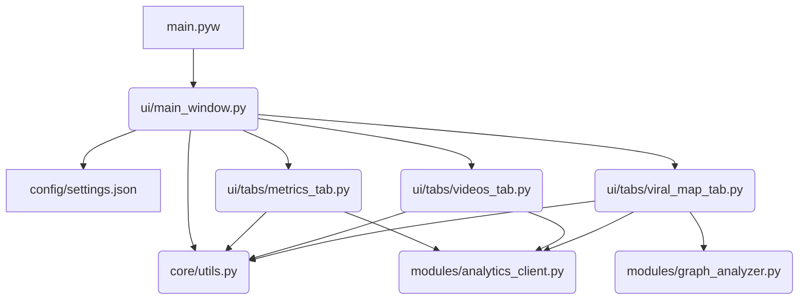

# Mapa de Arquitectura y Grafo (Estructura Limpia)

Este documento proporciona un grafo visual de las dependencias principales entre los módulos y un índice de acceso rápido a todos los archivos del sistema tras la reestructuración del proyecto.

## Grafo de Dependencias (Arquitectura)

---

## Índice de Acceso Rápido (Archivos y Componentes)

A continuación se mapean los archivos del proyecto para referencia rápida:

### 🚀 Entrada Principal
*   [main.pyw](file:///d:/Descargas/Desarrollo%20de%20aplicaciones/supergenerador/main.pyw)
    *   *Punto de inicialización de la app.*

### 🖥️ Interfaz de Usuario (UI)
*   [ui/main_window.py](file:///d:/Descargas/Desarrollo%20de%20aplicaciones/supergenerador/ui/main_window.py)
    *   `MainWindow` (Clase): Administra las vistas (`ChannelSetupView` para agregar y listar canales, y `show_dashboard_view` con soporte de pestañas internas).
*   [ui/tabs/metrics_tab.py](file:///d:/Descargas/Desarrollo%20de%20aplicaciones/supergenerador/ui/tabs/metrics_tab.py)
    *   `MetricsTab` (Clase): Interfaz del panel de analíticas avanzadas, cargador asíncrono y render de gráfico Matplotlib/Canvas.
*   [ui/tabs/videos_tab.py](file:///d:/Descargas/Desarrollo%20de%20aplicaciones/supergenerador/ui/tabs/videos_tab.py)
    *   `VideosTab` (Clase): Interfaz del listado de videos subidos dividido por canal, con cargador en hilos de fondo y redirección web.
*   [ui/tabs/viral_map_tab.py](file:///d:/Descargas/Desarrollo%20de%20aplicaciones/supergenerador/ui/tabs/viral_map_tab.py)
    *   `ViralMapTab` (Clase): Panel de Mapa de Viralidad con grafo de co-ocurrencia de redx/matplotlib y lista de palabras clave más virales.

### ⚙️ Lógica Central y Configuración
*   [core/utils.py](file:///d:/Descargas/Desarrollo%20de%20aplicaciones/supergenerador/core/utils.py)
    *   `get_resource_path()`: Obtiene rutas absolutas de recursos del sistema.
    *   `copy_to_clipboard_persistent()`: Copia de forma persistente al portapapeles.
    *   `force_focus()`: Fuerza foco en la ventana de CustomTkinter.
*   `config/settings.json`: Archivo que persiste los canales agregados por el usuario.

### 🧠 Módulos de Backend (APIs)
*   [modules/analytics_client.py](file:///d:/Descargas/Desarrollo%20de%20aplicaciones/supergenerador/modules/analytics_client.py)
    *   `get_authenticated_services()`: Inicializador de APIs de YouTube Analytics y YouTube Data v3.
    *   `fetch_channel_data_and_analytics()`: Extrae métricas agregadas de la API.
    *   `fetch_channel_videos()`: Obtiene los metadatos de los videos subidos de la lista de reproducción de subidas del canal.
    *   `get_mock_channel_analytics()`: Simulador de métricas.
    *   `get_mock_channel_videos()`: Simulador de videos.
*   [modules/graph_analyzer.py](file:///d:/Descargas/Desarrollo%20de%20aplicaciones/supergenerador/modules/graph_analyzer.py)
    *   `generate_viral_graph_data()`: Procesa descripciones, tags y transcripciones para generar datos de co-ocurrencias y scores por palabra clave.
