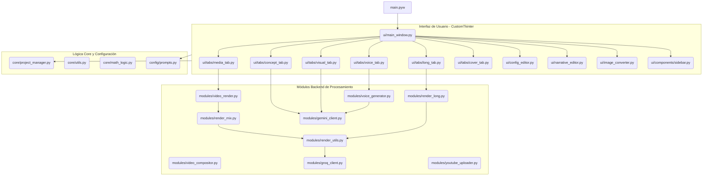

# Mapa de Arquitectura y Grafo de Acceso Rápido

Este documento proporciona un grafo visual de las dependencias principales entre los módulos y un índice de acceso rápido a todos los archivos, clases y funciones clave del sistema.

## Grafo de Dependencias (Arquitectura)

---

## Índice de Acceso Rápido (Archivos y Funciones)

A continuación se mapean todos los archivos fuente junto con sus componentes para referencias rápidas durante el desarrollo:

### 🚀 Entrada Principal
*   [main.pyw](file:///d:/Descargas/SilencioRojoApp/main.pyw)
    *   *Punto de inicialización de la app.*

### 🖥️ Interfaz de Usuario (UI)
*   [ui/main_window.py](file:///d:/Descargas/SilencioRojoApp/ui/main_window.py)
    *   `MainWindow` (Clase): Administra las vistas, la barra lateral y los bucles de auto-guardado (`auto_save_loop`).
*   [ui/components/sidebar.py](file:///d:/Descargas/SilencioRojoApp/ui/components/sidebar.py)
    *   `Sidebar` (Clase): Menú de navegación lateral.
*   [ui/config_editor.py](file:///d:/Descargas/SilencioRojoApp/ui/config_editor.py)
    *   `ConfigEditor` (Clase): Ajustes generales, API Keys y elección de templates de prompts.
*   [ui/narrative_editor.py](file:///d:/Descargas/SilencioRojoApp/ui/narrative_editor.py)
    *   `NarrativeEditor` (Clase): Editor de roles narrativos ("monstruos", "ganchos", etc.).
*   [ui/visual_prompt_viewer.py](file:///d:/Descargas/SilencioRojoApp/ui/visual_prompt_viewer.py)
    *   `VisualPromptViewer` (Clase): Pre-visualiza los prompts creados para plataformas como Midjourney.
*   [ui/image_converter.py](file:///d:/Descargas/SilencioRojoApp/ui/image_converter.py)
    *   `ImageConverter` (Clase): Convierte imágenes en lotes a resoluciones compatibles.

#### 🗂️ Pestañas de Interfaz (`ui/tabs/`)
*   [concept_tab.py](file:///d:/Descargas/SilencioRojoApp/ui/tabs/concept_tab.py): `ConceptTab` (Genera el guion).
*   [visual_tab.py](file:///d:/Descargas/SilencioRojoApp/ui/tabs/visual_tab.py): `VisualTab` (Genera prompts visuales por escena).
*   [cover_tab.py](file:///d:/Descargas/SilencioRojoApp/ui/tabs/cover_tab.py): `CoverTab` (Asistente de portadas).
*   [voice_tab.py](file:///d:/Descargas/SilencioRojoApp/ui/tabs/voice_tab.py): `VoiceTab` (Gestor individual de Text-to-Speech).
*   [media_tab.py](file:///d:/Descargas/SilencioRojoApp/ui/tabs/media_tab.py): `MediaTab` (Controlador y render de videos cortos/mix).
*   [long_tab.py](file:///d:/Descargas/SilencioRojoApp/ui/tabs/long_tab.py): `LongTab` (Segmentador de capítulos, gestor de caché y render pesado de videos largos).

### ⚙️ Lógica Central (Core & Config)
*   [core/project_manager.py](file:///d:/Descargas/SilencioRojoApp/core/project_manager.py)
    *   `ProjectManager` (Clase): `create_project()`, `save_project()`, `load_project()`, `list_projects()`.
*   [core/utils.py](file:///d:/Descargas/SilencioRojoApp/core/utils.py)
    *   `get_resource_path()`: Gestor de paths.
    *   `copy_to_clipboard_persistent()`: Gestor de portapapeles.
*   [core/math_logic.py](file:///d:/Descargas/SilencioRojoApp/core/math_logic.py)
    *   `calculate_visual_segments()`: Aplica lógicas de edición de video (como la regla de 3 seg).
*   [config/prompts.py](file:///d:/Descargas/SilencioRojoApp/config/prompts.py)
    *   `load_template()`, `save_narrative_vars()`, `load_settings_for_prompts()`: Funciones para manipular plantillas de IA.

### 🧠 Módulos de Procesamiento (Backend)
*   [modules/gemini_client.py](file:///d:/Descargas/SilencioRojoApp/modules/gemini_client.py)
    *   `generate_content()`: Principal puente con la IA (Text & Prompts).
*   [modules/groq_client.py](file:///d:/Descargas/SilencioRojoApp/modules/groq_client.py)
    *   `generate_content()`: Puente rápido con Groq (Whisper).
*   [modules/voice_generator.py](file:///d:/Descargas/SilencioRojoApp/modules/voice_generator.py)
    *   `generate_voice()`: Convierte el texto estructurado a archivos de audio.
*   [modules/render_utils.py](file:///d:/Descargas/SilencioRojoApp/modules/render_utils.py)
    *   `detect_hardware_encoder()`: Busca compatibilidad con QSV/NVENC.
    *   `transcribe_with_groq()`: Transcripción precisa de audio (SRT).
    *   `convert_to_word_by_word_ass()`: Estilizado y animado de los subtítulos virales.
*   [modules/video_render.py](file:///d:/Descargas/SilencioRojoApp/modules/video_render.py)
    *   `render_final_video()`: Enrutador maestro unificado.
*   [modules/render_mix.py](file:///d:/Descargas/SilencioRojoApp/modules/render_mix.py)
    *   `apply_audio_speed_ramping()`: Sincronización dinámica de audio.
    *   `render_mix_mode()`: Motor para ensamblar clips cortos usando FFmpeg.
*   [modules/render_long.py](file:///d:/Descargas/SilencioRojoApp/modules/render_long.py)
    *   `render_chapter()`: Convierte segmentos individuales en videos.
    *   `render_long_video_project()`: Fusiona capítulos y coordina el multiprocesamiento.
*   [modules/video_compositor.py](file:///d:/Descargas/SilencioRojoApp/modules/video_compositor.py)
    *   `VideoCompositor` (Clase): Manipula las matrices de video y escalado con OpenCV.
*   [modules/youtube_uploader.py](file:///d:/Descargas/SilencioRojoApp/modules/youtube_uploader.py)
    *   `get_authenticated_service()`, `upload_video()`: Acceso a YouTube API.
